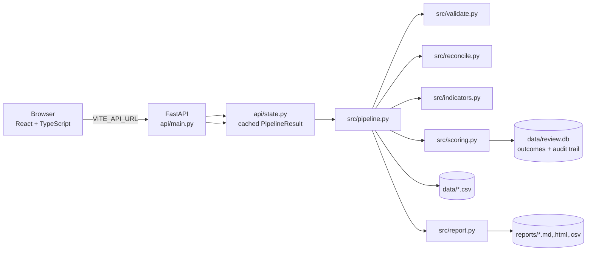

# Transaction Anomaly and Refund Investigation

A monitoring application that reconciles synthetic payment lifecycles, validates data quality,
computes explainable indicators, and ranks **unusual patterns** for manual review through a
polished FastAPI + React web frontend.

> **Disclaimer:** records are flagged for review because they show unusual patterns. Flags are
> review triggers, not determinations of intent. The UI never uses fraud labels.

## Quick start

```bash
# 1. Install Python and frontend dependencies
pip install -r requirements.txt
npm --prefix frontend install

# 2. Generate the deterministic synthetic dataset
python -m src.generate_data

# 3. Start both servers (choose one)
make dev                                  # macOS / Linux
powershell -File scripts/dev.ps1          # Windows
```

- Web UI: <http://localhost:5173>
- API docs: <http://localhost:8000/docs>
- API base URL is configured via `frontend/.env` (`VITE_API_URL`, see `.env.example`).

To run the servers separately:

```bash
uvicorn api.main:app --reload --host 127.0.0.1 --port 8000
npm --prefix frontend run dev
```

The former Streamlit application is preserved in `legacy/` and can still be run with
`streamlit run legacy/app.py`.

## Deployment

For a production single-process deployment, run `make serve` (or `powershell -File scripts/serve.ps1`),
which builds the SPA and serves it together with the API on <http://localhost:8000>. A multi-stage
`Dockerfile`, `docker-compose.yml`, reverse-proxy example, environment variables and cloud notes are
in [DEPLOYMENT.md](DEPLOYMENT.md). For a Vercel static frontend plus a separately hosted API with
Vercel KV-backed review outcomes, see [VERCEL.md](VERCEL.md).

## Architecture



## API contract

All endpoints are prefixed with `/api`; responses are Pydantic-validated JSON.

| Method | Path | Purpose |
|---|---|---|
| GET | `/api/health` | Service status and cache provenance |
| POST | `/api/reload` | Re-run the pipeline from CSV files |
| GET | `/api/overview` | KPIs, daily series, reason/priority distributions, needs-attention |
| GET | `/api/ledger` | Paginated, searchable, sortable reconciled ledger |
| GET | `/api/transactions/{id}` | Ledger row, raw events, refunds, status history, indicators, reasons, timeline |
| GET | `/api/review-queue` | Paginated queue with priority/reason/outcome/date/search filters |
| POST | `/api/review/{id}/outcome` | Set outcome + reviewer + notes (notes required for follow-up/escalated) |
| POST | `/api/review/bulk-outcome` | Bulk outcome for selected records |
| GET | `/api/audit-trail/{id}` | Append-only who/what/when history |
| GET | `/api/data-quality` | Rule summary, violation examples, state machine |
| GET | `/api/report` | Structured report sections and detection quality |
| GET | `/api/report/download/{md,html,csv}` | File downloads |

## Pages

1. **Overview** — five KPI cards with prior-period deltas, transactions-per-day area chart,
   captured vs refunded composite chart, flags-by-reason bar chart, priority donut, refund-ratio
   trend with threshold line, and a "needs attention" list of pending high-score items.
2. **Review Queue** — virtualized master-detail table with filters, sorting, bulk outcomes and
   keyboard shortcuts (`J`/`K` navigate, `Enter` opens, `1`–`4` preselect an outcome). The
   slide-over shows why a record was flagged (plain English + actual vs threshold), the payment
   lifecycle timeline, entity context, raw events with JSON toggle, the review form and audit trail.
3. **Reconciled Ledger** — dense virtualized table with column visibility, sorting, filters,
   CSV export and a raw-event drill-down showing reconciliation notes.
4. **Data Quality** — severity cards, expandable validation rules with example rows, a violations
   chart and the status state machine.
5. **Audit Report** — rendered report sections, precision/recall metrics, MD/HTML/CSV downloads
   and a print stylesheet.

## Design system

Dark-first fintech aesthetic (`#0B0D12` canvas), indigo/violet accent, 8px spacing grid,
rounded cards, soft shadows, Inter with tabular numerals for every amount. Semantic priority
colors (high red / medium amber / low blue) and outcome badges (pending gray, reviewed green,
follow-up amber, escalated red). 150–200ms transitions, skeleton loaders, empty/error states,
responsive layout, keyboard focus rings and WCAG-AA-contrast text. Light mode is available in
the top bar.

## Recent data-quality fix

The legacy overview counted every queue row, including customer/device records, and treated a
missing refund gap as `0`, so `FAST_REFUND` fired on almost every transaction. Missing indicators
are now preserved as `NaN`, and the flagged KPI counts **distinct transactions only**.

| Metric | Before | After |
|---|---|---|
| Distinct flagged transaction rate | 96.1% | **13.1%** |
| Precision (all flagged pairs) | 11.8% | **59.5%** |
| Recall on injected issues | 100% | **100%** |

Thresholds in `config.yaml` required no change; a regression test keeps the flag rate in the
5–15% band.

## Testing

```bash
python -m pytest -q          # backend + API + legacy smoke tests
npm --prefix frontend test   # Vitest + React Testing Library
npm --prefix frontend run build
npm --prefix frontend run lint
```

## Screenshots

Placeholders (add images under `docs/screenshots/`):


## Limitations

- Data is synthetic; thresholds are illustrative and should be recalibrated on real traffic.
- Timestamps are treated as naive local time; no timezone normalisation is applied.
- Multi-capture and multi-currency settlement are simplified to one canonical capture.
- Only `completed` refunds contribute to refund totals.
- Ground truth covers deliberate injections only, so many legitimate unusual patterns are also
  flagged; precision is intentionally conservative.
- Flags require human judgement; they are not assertions about intent or correctness.
